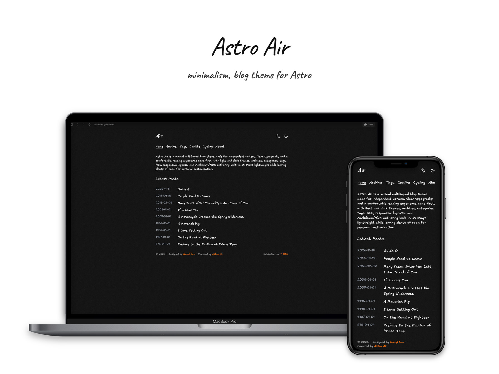

# Astro Air

[English](./README.md)

一个用 [Astro](https://astro.build) 写的多语言极简博客主题。

[astro-air.guoqi.dev](https://astro-air.guoqi.dev)



## 功能

- 英文、简体中文、繁体中文、日文、韩文。默认语言直接挂在 `/`。
- 首页、归档、标签、分类，以及独立页面
- 置顶、阅读时间，以及从 Git 读取的最后修改时间
- 宽屏目录，点击后平滑滚到对应标题
- 浅色 / 深色主题。列表标题会移进文章，主题像帘子一样揭开。
- 点击文中图片可以放大查看
- 一份收录全部已发布文章的 RSS
- 分页，也可以一页列出全部文章

动画怎么接在一起，写在 [docs/animations.md](./docs/animations.md)。

## 环境

[Bun](https://bun.sh) 1.4.4 或更高版本。`package.json` 里的 `packageManager` 固定为 `bun@1.4.4`。

## 开始

```bash
git clone https://github.com/sun0225SUN/astro-air
cd astro-air
bun install
bun dev
```

`src/config.ts` 里的 `defaultLocale` 直接挂在 `/`，不带语言前缀。其余语言保留前缀；默认是英文时，中文就是 `/zh/`。改 `defaultLocale` 就会把那种语言换到域名根上，中间没有跳转页。

第一次打开没有语言前缀的页面时，如果浏览器语言在 `locales` 里，会打开对应语言。页头的语言按钮会记住这次选择，之后再访问也保持它。已经带前缀的地址，例如 `/ja/posts/hello`，就停在那个语言。

| 命令 | 作用 |
| --- | --- |
| `bun dev` | 启动开发服务器 |
| `bun run build` | 把静态站点构建到 `dist/` |
| `bun run preview` | 预览构建结果 |
| `bun run lint` | 用 Biome 检查格式和代码 |
| `bun run format` | 用 Biome 格式化 |

`bunfig.toml` 让包脚本跑在 Bun 上。Astro 命令行自带 Node 的 shebang，没有这一项时 `bun run` 会改用 Node。

## 目录

```text
src/config.ts              站点身份、语言、导航、每页篇数
messages/                  界面文案，每种语言一个 JSON
src/content/blog/<语言>    文章。公开地址是 /posts，不是这个文件夹。
src/content/pages/<语言>   关于这类独立页面
src/styles/                设计令牌、主题帘子、正文动画、排版、图片、导航
docs/animations.md         动画说明
```

## 配置

站点只认 `src/config.ts`：

```ts
export const config = {
  title: 'Air',
  author: 'Guoqi Sun',
  description: {
    default: 'A minimal multilingual blog theme.',
    zh: '一个多语言极简博客主题。',
  },
  favicon: [
    { href: '/favicon.svg', type: 'image/svg+xml' },
    { href: '/favicon.ico' },
  ],
  url: 'https://astro-air.guoqi.dev',
  defaultLocale: 'en',
  locales: ['en', 'zh', 'zh-tw', 'ja', 'ko'],
  handwriting: true,
  blog: {
    // 正整数，或者 'all' 表示一页显示全部文章。
    perPage: 10,
  },
  nav: [
    'home',
    'archive',
    'tags',
    'about',
  ],
}
```

`description` 同时提供首页文案、SEO 描述和 RSS 描述。用语言代码配置译文，`default` 是回退值。`favicon` 中的每一项都会生成一个 `<link rel="icon">`，对应文件放在 `public/`。`url` 是 Astro 和 RSS 使用的站点正式地址。`handwriting: true` 让标题和正文使用手写字体。

`locales` 同时决定有哪些语言、按什么顺序切换。语言按钮按这个顺序循环，并能尽量留在当前页面。每个语言代码都要有一份 `messages/<代码>.json`，键结构和 `messages/en.json` 一致。缺文件时构建会失败。组件里用 `t('blog.latest')` 读取这些嵌套键。

`nav` 里可以混用三种项目，顺序就是顶栏顺序：

| 写法 | 结果 |
| --- | --- |
| `'home'` | 首页。文案来自 `nav.home`。 |
| `'archive'` 或 `'blog'` | `/posts` 归档。文案来自 `nav.archive`。 |
| `'tags'` | `/posts/tag` 标签页。文案来自 `nav.tags`。 |
| `'about'` | 文件名是 `about` 的独立页面，用那一页自己的标题。 |
| `{ link, label }` | 任意链接。`label.default` 是兜底文案，可以再写 `zh`、`ja` 等语言覆盖。 |

`blog.perPage` 是正整数。写成 `'all'` 时，一页显示全部文章。

## 写文章

在 `src/content/blog/<语言>/` 下新建 `.md` 或 `.mdx`。文件名就是 slug。文件夹会进 URL。默认语言下，`notes/hello.md` 对应 `/posts/notes/hello`；其他语言对应 `/<语言>/posts/notes/hello`。

```markdown
---
title: 第一篇文章
description: 这篇文章讲怎么写、怎么发布。
pubDate: 2024-07-08
updatedDate: 2024-08-01
draft: false
pin: 0
category: 笔记
tags:
  - 写作
  - markdown
---
```

`title`、`description`、`pubDate` 必填。`updatedDate`、`draft`、`pin`、`category`、`tags` 可选。`tags` 默认是空数组。`pin` 取 1 到 99 时，文章固定在首页列表顶部，数字越大越靠前。`0` 按日期排序。

`draft: true` 在 `bun dev` 里仍然看得到，`bun run build` 和 RSS 会把它排除。

翻译一篇文章时，在各语言目录下放同名文件。没有文件的语言就没有这个 slug。

归档按年份分组，日期显示为 `MM-DD`。首页和标签页显示 `YYYY-MM-DD`。访问过的标题会变成紫色。

`h2` 和 `h3` 会进入宽屏上的目录。点击目录项会平滑滚到对应标题。

## 写独立页面

独立页面放在 `src/content/pages/<语言>/`。去掉扩展名后的文件名就是 URL。默认语言下，`about.mdx` 是 `/about`；其他语言是 `/<语言>/about`。

```markdown
---
title: 关于
description: 和其他独立页面放在一起的自定义页面。
order: 1
draft: false
---
```

`title` 和 `description` 必填。`order` 用于页面之间的排序。`draft` 的规则和文章相同。

想出现在顶栏里，就把 slug 写进 `nav`，例如 `'about'`。名为 `posts` 的文件被路由占用，不会当成独立页面。

MDX 可以引入 `src/components/` 里的组件。

## 界面文案

改 `messages/en.json`、`messages/zh.json`、`messages/zh-tw.json`、`messages/ja.json`、`messages/ko.json`。键是嵌套的。组件里 `t('post.readingTime', { minutes })` 会把字符串中的 `{minutes}` 换掉。

增加一种语言：

1. 把语言代码追加到 `src/config.ts` 的 `locales`。
2. 新建 `messages/<代码>.json`，键和 `messages/en.json` 相同。
3. 在 `src/content/blog/<代码>/` 和 `src/content/pages/<代码>/` 放内容。

`defaultLocale` 必须是 `locales` 里的一项。

## 统计

只有两个变量都有值时才会加载 Umami。本地把 `.env.example` 复制成 `.env`，线上在托管平台设置同样的变量。

```bash
UMAMI_URL=https://umami.example
UMAMI_WEBSITE_ID=your-website-id
```

`UMAMI_URL` 是 Umami 的源站地址，不要以斜杠结尾。站点会加上 `/script.js` 和 `/recorder.js`，并把 `UMAMI_WEBSITE_ID` 写进 `data-website-id`。自定义事件只加在按钮上，目前只有主题切换。链接不加 `data-umami-event`，否则 Umami 会取消点击，页面过渡就不会发生。

## RSS

`/rss.xml` 收录所有语言里已发布的文章。每条链接都指向对应语言的地址，默认语言不带前缀。草稿不会出现。

## 许可证

[GPL-3.0-only](./LICENSE)
